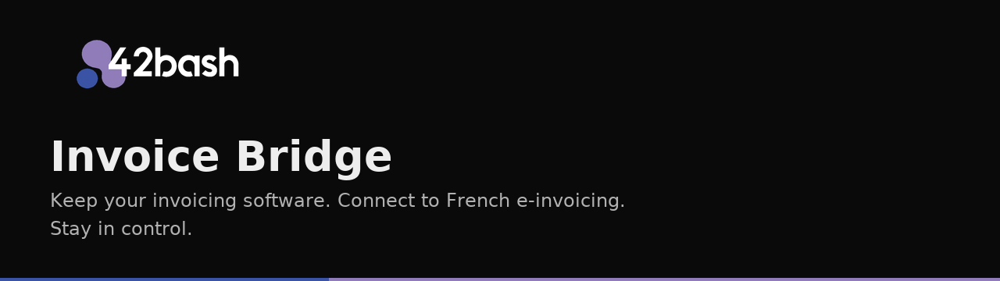
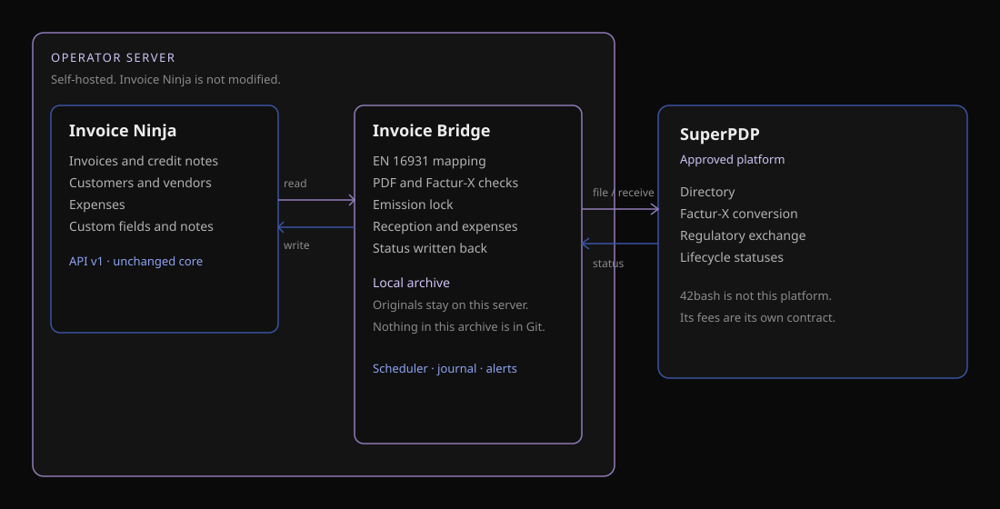
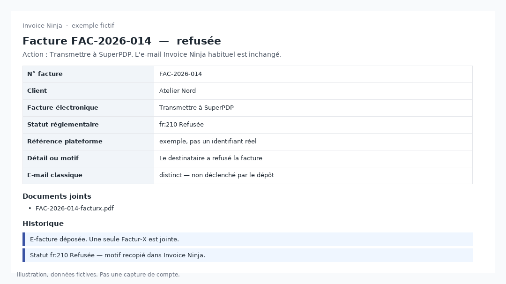
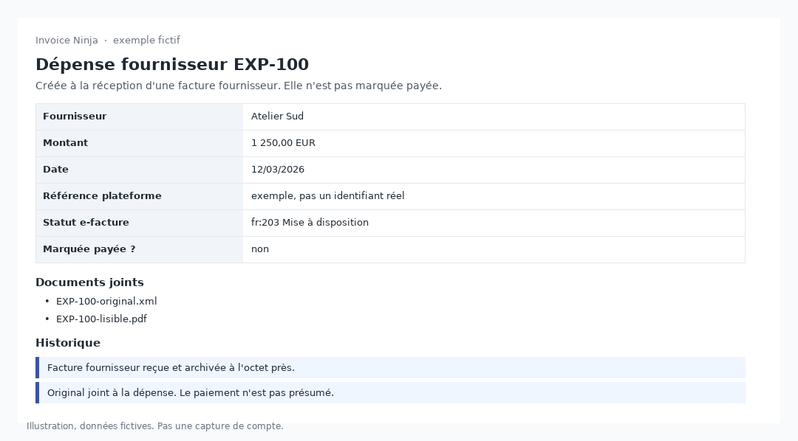
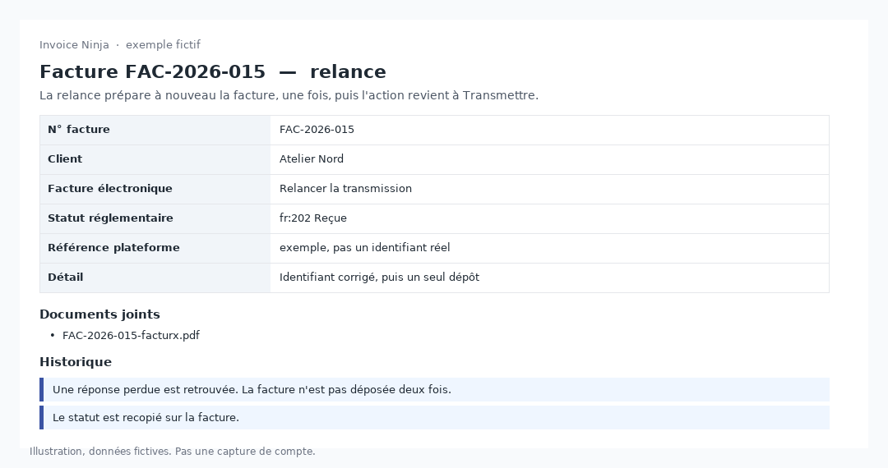
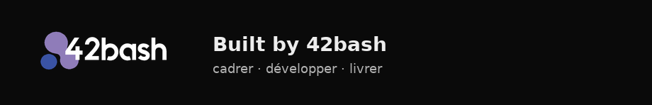

# 42bash Invoice Bridge

[](https://github.com/42bash/invoice-bridge/actions/workflows/ci.yml)
[](LICENSE)
[](https://www.php.net/)
[](https://laravel.com/)
[](https://docs.docker.com/)
[](CHANGELOG.md)

**Bêta publique.** English documentation: [README.md](README.md).



> Conservez votre logiciel de facturation. Connectez-vous à la facturation électronique française. Gardez la maîtrise de vos données.

42bash Invoice Bridge est un service auto-hébergé qui relie [Invoice Ninja](https://invoiceninja.com) à une plateforme agréée française. [SuperPDP](https://www.superpdp.tech) est la première plateforme prise en charge. Invoice Ninja reste le logiciel de facturation. Le connecteur prépare la facture électronique, la contrôle, la dépose ou la reçoit, puis recopie le statut réglementaire.

**42bash n'est pas une plateforme agréée.** SuperPDP assure les échanges réglementaires. Un PDF envoyé par e-mail n'est pas une facture électronique. Ce connecteur n'est pas une garantie universelle de conformité fiscale. Il ne revendique aucune certification, affiliation ou reconnaissance officielle.

## Bêta publique

Version **0.1.0-beta.2**. La préversion précédente, `v0.1.0-beta.1`, reste disponible.

| | |
| --- | --- |
| Émission et réception | Testées dans le bac à sable SuperPDP, avec des sociétés fictives |
| Réception | Activée sur une installation de production |
| Émission réelle | Pas encore validée. Verrouillée tant que l'opérateur ne l'ouvre pas |
| Cas fiscaux et réglementaires | Une partie des cas n'est pas prise en charge. Voir les [limites](docs/LIMITATIONS.md) |
| Qui dépose la facture | SuperPDP, en tant que plateforme agréée |
| Qui publie le connecteur | 42bash, qui n'est pas une plateforme agréée |
| Frais SuperPDP | Facturés par SuperPDP au titre de son propre contrat, indépendants de ce connecteur gratuit |

## Le cadre français

La facture PDF jointe à un e-mail cède la place à une facture électronique structurée entre entreprises. Elle doit passer par une plateforme agréée, sous une forme que cette plateforme peut traiter (Factur-X / EN 16931), et le statut de son cycle de vie doit revenir dans l'outil qui l'a émise.

Invoice Ninja ne parle pas ce protocole. Le remplacer imposerait de migrer l'historique, les clients et les habitudes de ceux qui s'en servent. Le connecteur laisse Invoice Ninja en place et fait le travail de protocole à côté.

## Garder Invoice Ninja auto-hébergé

Les données de facturation restent sur le serveur qui héberge déjà Invoice Ninja. Le connecteur est un second service sur ce serveur. Il ne modifie pas le code d'Invoice Ninja, il ne réécrit pas les factures déjà émises, et il n'exige pas de compte chez 42bash. Les secrets, l'identité de la société et l'archive restent dans la configuration et le stockage de l'opérateur.

## Le rôle de SuperPDP

SuperPDP est la plateforme agréée configurée par cette version. Elle tient l'annuaire, convertit et valide la Factur-X, porte la facture jusqu'au destinataire et renvoie le statut. L'acceptation technique par SuperPDP ne signifie pas, à elle seule, que tous les cas fiscaux sont couverts. Le contrat d'API et les éventuels frais se concluent avec SuperPDP, pas avec ce projet.

## Architecture



Invoice Ninja est lu et mis à jour par son API. Le connecteur transpose la facture en EN 16931, compare le PDF aux montants, et refuse de déposer un document qu'il ne peut pas contrôler. Les originaux sont archivés sur le disque de l'opérateur, hors de Git. Un planificateur synchronise les statuts. Les alertes vont au journal et, si on les configure, à l'e-mail ou à un webhook. Le détail est dans [docs/fr/architecture.md](docs/fr/architecture.md).

## Ce qu'il fait

- Recevoir une facture fournisseur, archiver l'original à l'octet près, créer le fournisseur et la dépense, sans marquer cette dépense payée.
- Préparer une Factur-X depuis une facture, un avoir ou un acompte Invoice Ninja, sans la déposer.
- Déposer ces documents lorsque l'émission est explicitement ouverte. Elle est fermée par défaut.
- Recopier dans Invoice Ninja le statut réglementaire, la référence de la plateforme et le motif d'un rejet. Une seule Factur-X est jointe.
- Déclarer une vente B2C et un encaissement lorsque ces options sont ouvertes. Elles sont fermées par défaut.
- Bloquer un client B2B absent de l'annuaire, en expliquant pourquoi.
- Bloquer un PDF illisible, ou un PDF dont les montants de ligne ne sont pas réellement imprimés. Un total, un net à payer ou l'indemnité forfaitaire de 40 € ne valident pas une ligne.
- Relancer une transmission en échec, une fois, depuis Invoice Ninja. Une réponse perdue est retrouvée et n'est pas déposée une seconde fois.
- Sur une facture verrouillée par Invoice Ninja, inscrire le statut dans l'historique d'activité au lieu de modifier les montants. L'API refuse les autres mises à jour (HTTP 422, `locked_invoice`).

## Captures

Les images ci-dessous sont des illustrations avec des sociétés fictives. Ce ne sont pas des captures d'un compte.







## Prérequis

- Docker et Docker Compose
- Invoice Ninja 5.14, API v1, et un jeton d'API
- Un compte SuperPDP : le bac à sable pour les essais, un contrat d'API pour la production
- HTTPS devant Invoice Ninja et SuperPDP, sauf instance de test interne à Docker

## Installation rapide

```bash
git clone git@github.com:42bash/invoice-bridge.git
cd invoice-bridge
cp .env.example .env
chmod 600 .env
# URL et jeton Invoice Ninja, identifiants SuperPDP, messagerie, et votre société.
./scripts/install.sh
docker compose exec invoice-bridge php artisan einvoicing:setup-fields --apply
docker compose exec invoice-bridge php artisan einvoicing:check
```

Tous les interrupteurs restent coupés tant que `einvoicing:check` n'est pas vert. La réception peut ensuite être ouverte seule :

```env
EINVOICING_ENABLED=true
EINVOICING_AUTO_RECEIVE=true
EINVOICING_SEND_ENABLED=false
```

Recréez les conteneurs après chaque modification du `.env`. La procédure complète est dans [docs/fr/installation.md](docs/fr/installation.md).

La même version est aussi publiée sous `ghcr.io/42bash/invoice-bridge:0.1.0-beta.2`. `ghcr.io/42bash/invoice-bridge:0.1.0-beta.1` reste disponible. Il n'y a pas d'étiquette `latest`. Le fichier Compose de ce dépôt construit la version courante depuis les sources.

## Documentation

| | |
| --- | --- |
| Installation | [docs/fr/installation.md](docs/fr/installation.md) |
| Configuration | [docs/fr/configuration.md](docs/fr/configuration.md) |
| Usage | [docs/fr/utilisateur.md](docs/fr/utilisateur.md) |
| Architecture | [docs/fr/architecture.md](docs/fr/architecture.md) |
| Déploiement | [docs/fr/deploiement.md](docs/fr/deploiement.md) |
| Mise à jour | [docs/fr/mise-a-jour.md](docs/fr/mise-a-jour.md) |
| Désinstallation | [docs/fr/desinstallation.md](docs/fr/desinstallation.md) |
| Compatibilité | [docs/COMPATIBILITY.md](docs/COMPATIBILITY.md) |
| Limites | [docs/LIMITATIONS.md](docs/LIMITATIONS.md) |
| Périmètre testé pour cette bêta | [docs/ACCEPTANCE.md](docs/ACCEPTANCE.md) |

Les guides en anglais sont sous [docs/en/](docs/en/installation.md).

## Limites connues

La liste est tenue dans [docs/LIMITATIONS.md](docs/LIMITATIONS.md). En bref : un seul régime de TVA par installation, pas d'e-reporting des achats à l'étranger, pas de traitement particulier des factures récurrentes, pas de mélange de codes d'exonération sur une même facture, une absence dans l'annuaire bloque la facture, et il n'y a pas de bouton spécifique dans Invoice Ninja. Les factures déjà émises qui ne correspondent pas au régime configuré ne sont ni modifiées ni transmises.

## Sécurité

Les secrets restent dans `.env`, en droits 600, jamais dans Git. Le tableau de bord ne démarre pas sans empreinte de mot de passe, et il n'écoute que sur localhost. N'ouvrez pas l'émission avant d'avoir relu l'aperçu de la facture réelle. Une vulnérabilité se signale en privé, comme indiqué dans [SECURITY.md](SECURITY.md). N'ouvrez pas un ticket public qui contiendrait un jeton, une facture, un identifiant fiscal ou un journal non expurgé.

## Contribution

Les tickets et les propositions de correction sont les bienvenus pour un défaut, un correctif de sécurité, un échec d'installation ou une documentation inexacte. N'envoyez ni identifiants, ni factures, ni données fiscales. Décrivez le comportement, la version, et ce que vous attendiez. C'est une bêta : une fonction nouvelle suppose un besoin concret de quelqu'un qui l'exploite.

## Licence

[Apache 2.0](LICENSE). La bibliothèque `smalot/pdfparser` reste sous LGPL-3.0 et n'est pas modifiée. Voir [NOTICE](NOTICE).

## Construit par 42bash

[](https://42bash.com)

42bash cadre, développe et livre des systèmes numériques pour les entreprises : applications métier, automatisation, intégrations d'API et architectures qui restent maintenables en production. Cette pratique existe depuis 2007.

[42bash.com](https://42bash.com)
