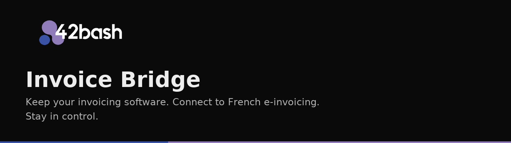
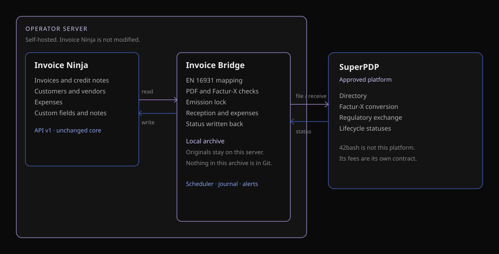
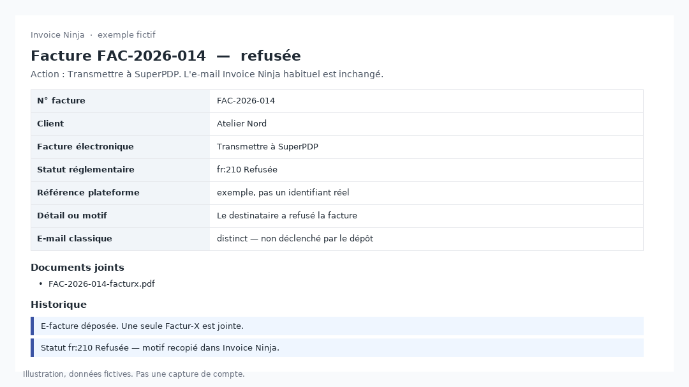
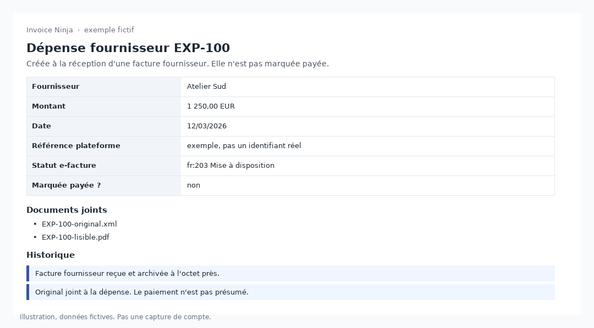
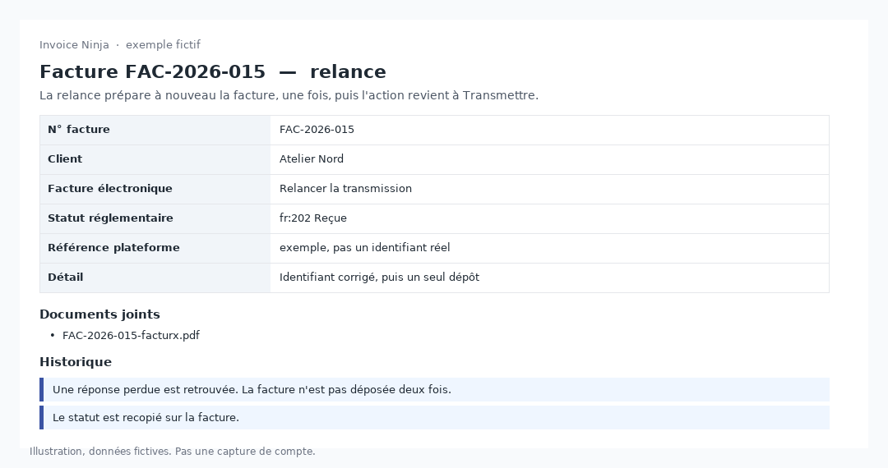
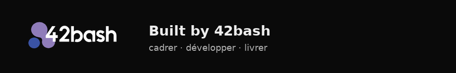

# 42bash Invoice Bridge

[](https://github.com/42bash/invoice-bridge/actions/workflows/ci.yml)
[](LICENSE)
[](https://www.php.net/)
[](https://laravel.com/)
[](https://docs.docker.com/)
[](CHANGELOG.md)

**Public beta.** Documentation en français : [README.fr.md](README.fr.md).



> Keep your invoicing software. Connect to French e-invoicing. Stay in control.

42bash Invoice Bridge is a self-hosted service that connects [Invoice Ninja](https://invoiceninja.com) to a French approved e-invoicing platform. [SuperPDP](https://www.superpdp.tech) is the first platform supported. Invoice Ninja remains the invoicing application. The bridge prepares the electronic invoice, checks it, files or receives it, and writes the regulatory status back.

**42bash is not an approved platform** (*plateforme agréée*). SuperPDP performs the regulatory exchange. A PDF sent by e-mail is not an electronic invoice. This connector is not a universal guarantee of tax compliance. It claims no certification, affiliation, or official recognition.

## Public beta

Version **0.1.0-beta.1**.

| | |
| --- | --- |
| Emission and reception | Tested in the SuperPDP sandbox, with fictitious companies |
| Reception | Enabled on one production installation |
| Real emission | Not validated yet. Locked unless the operator turns it on |
| Tax and regulatory cases | Some cases are not supported. See [limitations](docs/LIMITATIONS.md) |
| Who files the invoice | SuperPDP, as an approved platform |
| Who publishes the connector | 42bash, which is not an approved platform |
| SuperPDP fees | Charged by SuperPDP under its own contract, independent of this free connector |

## The French requirement

France is replacing the PDF attached to an e-mail with structured electronic invoicing between businesses. The invoice has to travel through an approved platform, in a form that platform can process (Factur-X / EN 16931), and the lifecycle status has to come back to the tool that issued it.

Invoice Ninja does not speak that protocol. Replacing it would mean migrating the invoicing history, the customers, and the habits of the people who use it. The bridge leaves Invoice Ninja in place and does the protocol work beside it.

## Keep a self-hosted Invoice Ninja

The invoicing data stays on the server that already runs Invoice Ninja. The connector is a second service on that server. It does not modify Invoice Ninja’s source code, it does not rewrite invoices that were already issued, and it does not require an account at 42bash. Credentials, the company identity, and the archive remain in the operator’s configuration and storage.

## What SuperPDP does

SuperPDP is the approved platform configured by this version. It holds the directory, converts and validates the Factur-X, carries the invoice to the counterpart, and returns the lifecycle status. Technical acceptance by SuperPDP is not, by itself, a statement that every tax case is covered. The API contract and any fee are agreed with SuperPDP, not with this project.

## Architecture



Invoice Ninja is read and updated through its API. The bridge maps the invoice to EN 16931, compares the PDF with the amounts, and refuses to file a document it cannot check. Originals are archived on the operator’s disk, outside Git. A scheduler synchronises statuses. Alerts go to the journal and, if configured, to e-mail or a webhook. The detail is in [docs/en/architecture.md](docs/en/architecture.md).

## What it does

- Receives a supplier invoice, archives the original byte for byte, creates the vendor and the expense, and does not mark that expense paid.
- Prepares a Factur-X from an Invoice Ninja invoice, a credit note, or a deposit invoice, without filing it.
- Files those documents when emission is explicitly enabled. Emission is off by default.
- Writes the regulatory status, the platform reference, and a rejection reason back to Invoice Ninja. One Factur-X is attached.
- Reports a B2C sale and a collected payment when those options are enabled. They are off by default.
- Blocks a B2B customer who is not in the directory, and says why.
- Blocks an unreadable PDF, or a PDF whose line amounts are not actually printed. A total, an amount due, or the 40 € recovery indemnity does not count as a line.
- Retries a failed transmission once from Invoice Ninja. A lost response is recovered and is not filed a second time.
- On a locked Invoice Ninja invoice, records the status in the activity history instead of changing amounts. Invoice Ninja’s API refuses other updates (HTTP 422, `locked_invoice`).

## Screenshots

The pictures below are illustrations with fictitious companies. They are not captures of an account.







## Requirements

- Docker and Docker Compose
- Invoice Ninja 5.14, API v1, and an API token
- A SuperPDP account: the sandbox for tests, an API contract for production
- HTTPS in front of Invoice Ninja and SuperPDP, except a Docker-internal test instance

## Quick install

```bash
git clone git@github.com:42bash/invoice-bridge.git
cd invoice-bridge
cp .env.example .env
chmod 600 .env
# Invoice Ninja URL and token, SuperPDP credentials, mail, and your own company.
./scripts/install.sh
docker compose exec invoice-bridge php artisan einvoicing:setup-fields --apply
docker compose exec invoice-bridge php artisan einvoicing:check
```

Leave every switch off until `einvoicing:check` is green. Reception can then be enabled on its own:

```env
EINVOICING_ENABLED=true
EINVOICING_AUTO_RECEIVE=true
EINVOICING_SEND_ENABLED=false
```

Recreate the containers after any change to `.env`. The full procedure is in [docs/en/installation.md](docs/en/installation.md).

The same version is also published as `ghcr.io/42bash/invoice-bridge:0.1.0-beta.1`. There is no `latest` tag. The Compose file in this repository builds that version from source.

## Documentation

| | |
| --- | --- |
| Install | [docs/en/installation.md](docs/en/installation.md) |
| Configuration | [docs/en/configuration.md](docs/en/configuration.md) |
| Day to day use | [docs/en/user-guide.md](docs/en/user-guide.md) |
| Architecture | [docs/en/architecture.md](docs/en/architecture.md) |
| Deployment | [docs/en/deploy.md](docs/en/deploy.md) |
| Upgrade | [docs/en/upgrade.md](docs/en/upgrade.md) |
| Uninstall | [docs/en/uninstall.md](docs/en/uninstall.md) |
| Compatibility | [docs/COMPATIBILITY.md](docs/COMPATIBILITY.md) |
| Limitations | [docs/LIMITATIONS.md](docs/LIMITATIONS.md) |
| What the beta was tested against | [docs/ACCEPTANCE.md](docs/ACCEPTANCE.md) |

French guides live under [docs/fr/](docs/fr/installation.md).

## Known limitations

The list is maintained in [docs/LIMITATIONS.md](docs/LIMITATIONS.md). In short: one VAT regime per installation, no e-reporting of purchases from abroad, no special path for recurring invoices, no mix of exemption codes on one invoice, a directory miss blocks the invoice, and there is no custom button inside Invoice Ninja. Historical invoices that do not match the configured regime are left untouched and are not transmitted.

## Security

Secrets stay in `.env`, mode 600, and never in Git. The dashboard does not start until a password hash is set, and it binds to localhost. Do not enable emission until a preview of the real invoice has been reviewed. Report a vulnerability privately, as described in [SECURITY.md](SECURITY.md). Do not open a public issue that contains a token, an invoice, a tax identifier, or an unsanitised log.

## Contributing

Issues and pull requests are welcome for a defect, a security fix, an installation failure, or a correction of the documentation. Please do not send credentials, invoices, or tax data. Open a discussion or an issue with the behaviour, the version, and what you expected. This is a beta: a new feature needs a concrete need from someone running it.

## Licence

[Apache 2.0](LICENSE). `smalot/pdfparser` remains LGPL-3.0 and is used unmodified. See [NOTICE](NOTICE).

## Built by 42bash

[](https://42bash.com)

42bash frames, builds, and delivers digital systems for companies: business applications, automation, API integrations, and architectures that stay maintainable in production. The practice has been doing that work since 2007.

[42bash.com](https://42bash.com)
