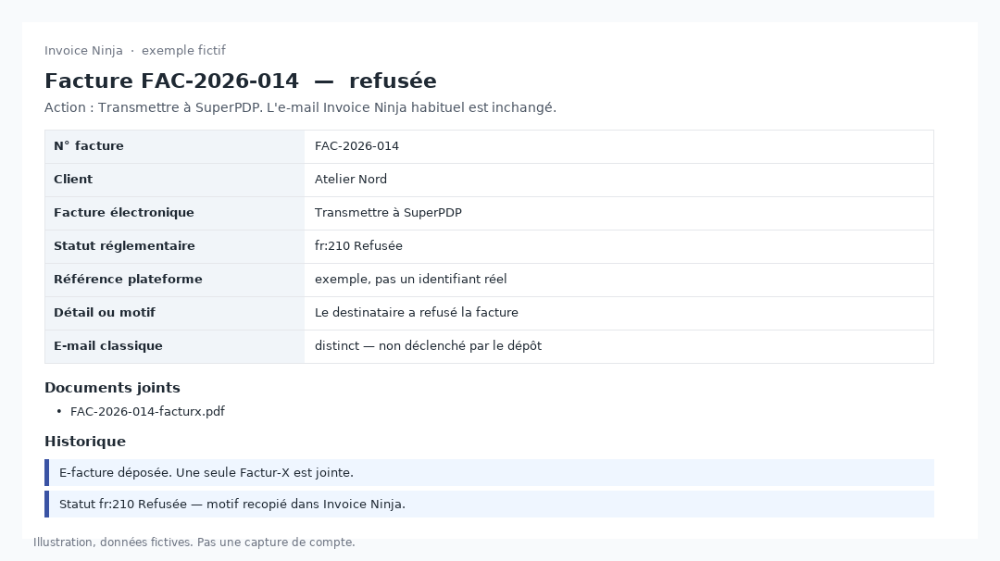
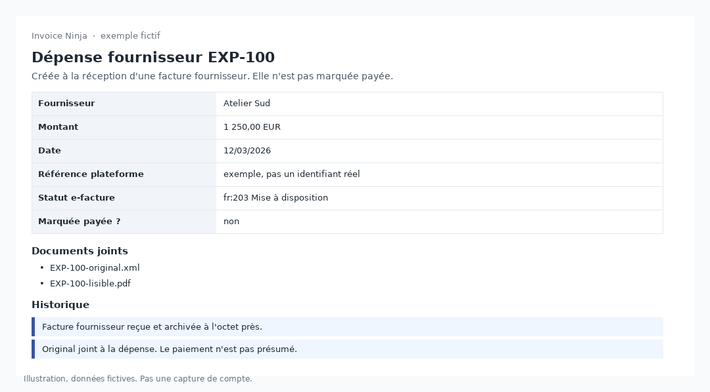
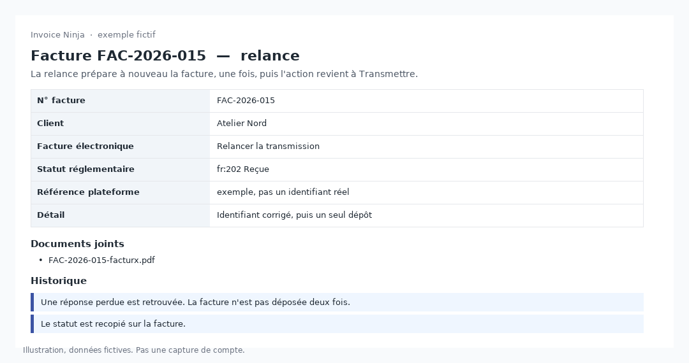

# User guide

On an issued Invoice Ninja invoice (not a draft):

1. **Send to SuperPDP** prepares the Factur-X and uploads it when emission is enabled.
2. **Send to SuperPDP (deposit)** uses the deposit type code.
3. **Do not send** skips the invoice.
4. **Retry transmission** prepares a blocked or technically failed invoice once, then the field returns to “Send to SuperPDP”.

The connector fills **Regulatory status**, **SUPER PDP transmission** (id and date), and **Detail or rejection reason**. The validated Factur-X is attached under Documents. Activity notes prefixed with “E-facture” are the exchange history.

A locked Invoice Ninja invoice rejects every API update except marking it paid (HTTP 422, `locked_invoice`), so the custom fields cannot carry the status. The connector does not unlock the invoice and does not change any amount. It records the status in the activity history and tries the fields again on a later sync.

E-mailing the customer from Invoice Ninja does not file the invoice. Leave Invoice Ninja’s own e-invoice switch off so it does not attach a second, unvalidated XML.

Received supplier invoices become a vendor and an expense, with the original attached. The expense is not marked paid.

These pictures are illustrations, with fictitious companies. They are not captures of an account.
