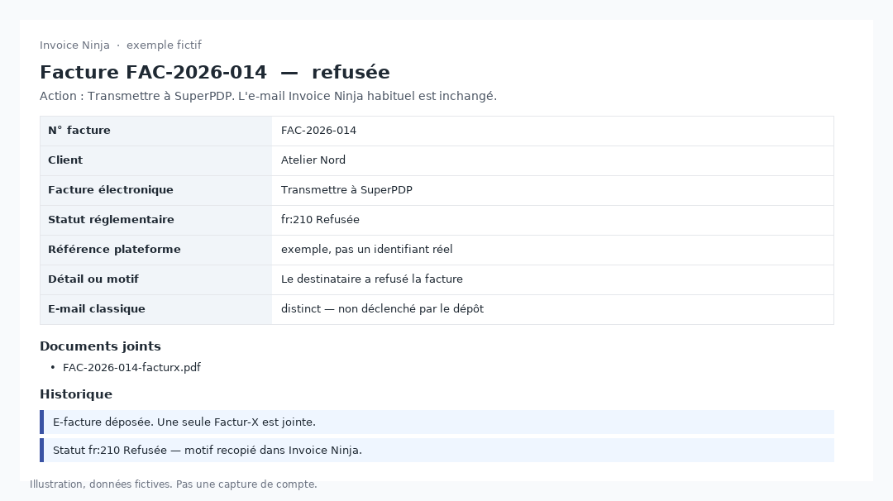
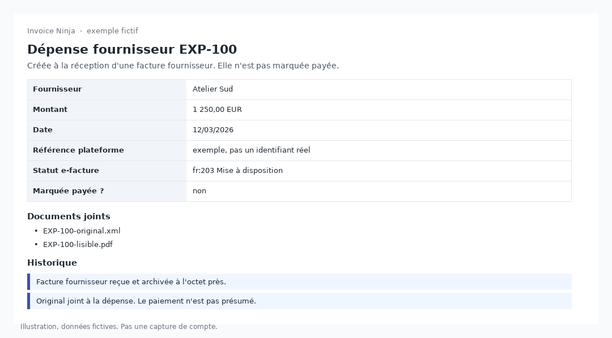
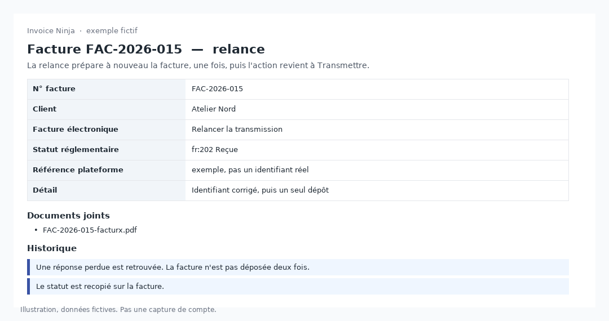

# Guide utilisateur

Dans Invoice Ninja, sur une facture déjà émise (pas un brouillon) :

1. **Transmettre à SuperPDP** demande la préparation, puis le dépôt si l'émission est autorisée.
2. **Transmettre à SuperPDP (acompte)** utilise le type d'acompte.
3. **Ne pas transmettre** ignore la facture.
4. **Relancer la transmission** reprépare une facture bloquée ou en erreur technique, une seule fois, puis le champ revient à « Transmettre à SuperPDP ».

Le connecteur remplit :

- **Statut réglementaire** (code et libellé, avec la date) ;
- **Transmission SuperPDP** (identifiant et date de dépôt) ;
- **Détail ou motif de rejet**.

La Factur-X validée est jointe dans l'onglet Documents. L'historique est dans l'onglet Activité (notes « E-facture »).

Une facture verrouillée par Invoice Ninja refuse toute mise à jour de l'API, hormis le marquage « payée » (HTTP 422, `locked_invoice`). Les champs personnalisés ne peuvent alors pas porter le statut. Le connecteur ne déverrouille pas la facture et ne modifie aucun montant : il inscrit le statut dans l'historique d'activité, et réessaie les champs à une synchronisation suivante.

L'envoi d'e-mail au client depuis Invoice Ninja ne dépose pas la facture. La facturation électronique native d'Invoice Ninja doit rester désactivée pour ne pas joindre un second XML non validé.

Les factures fournisseurs reçues deviennent un fournisseur et une dépense, avec l'original joint. La dépense n'est pas marquée payée.

Ces images sont des illustrations, avec des sociétés fictives. Ce ne sont pas des captures d'un compte.
